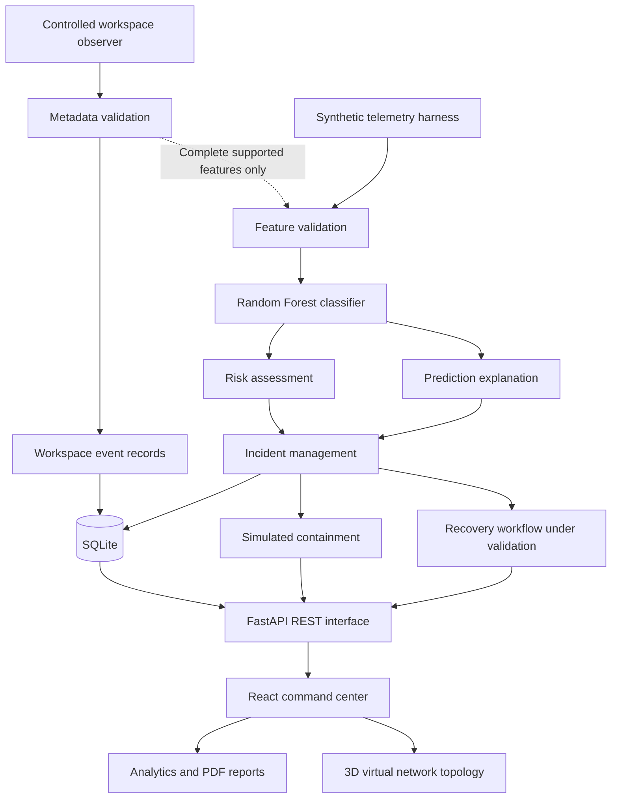
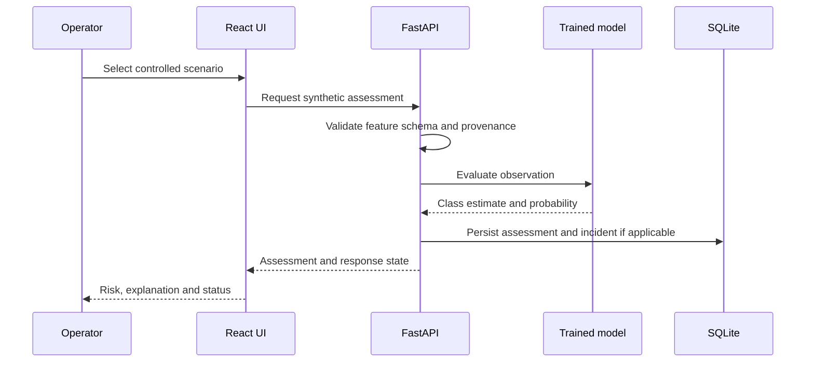
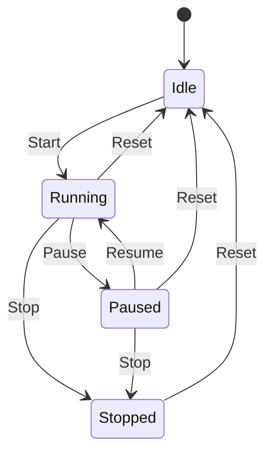
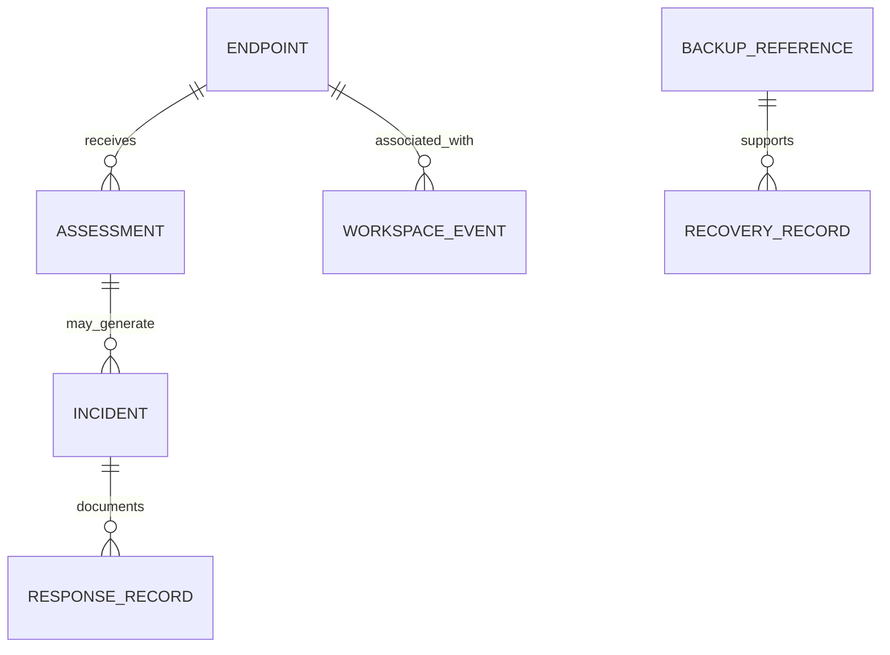
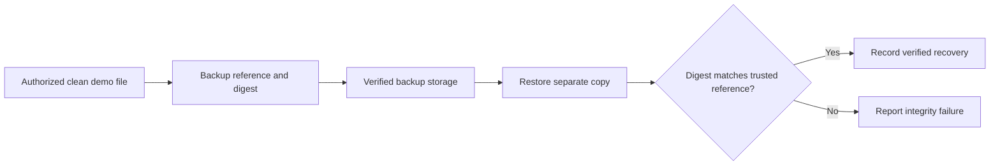
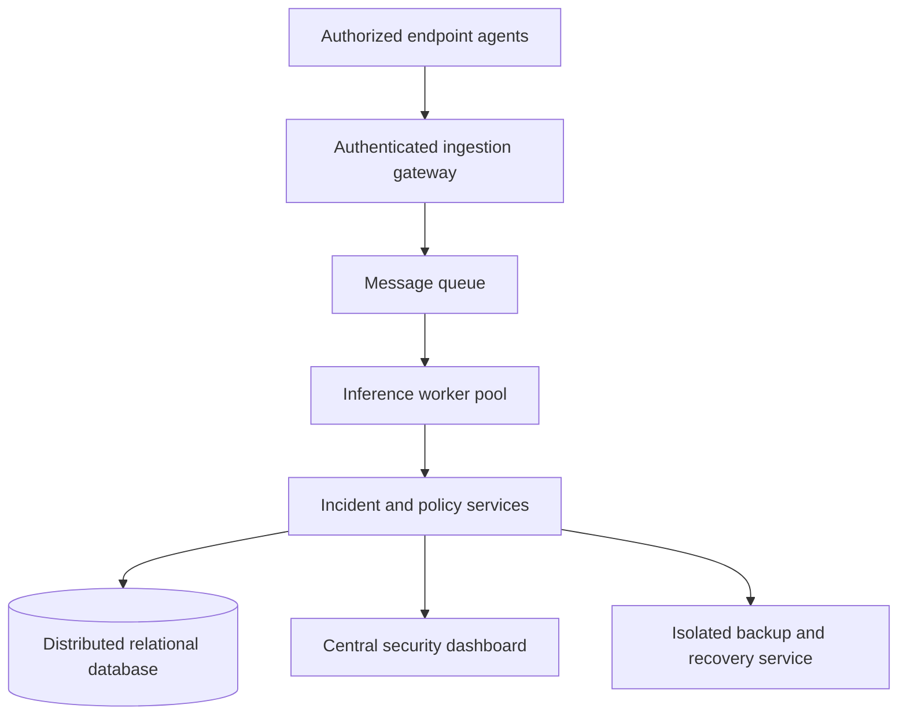

# NexusSentinel
Nexus Sentinel is an AI-powered cybersecurity prototype for FinTech, combining behavioural ransomware detection, explainable Random Forest intelligence, early warning, false-positive reduction, simulated containment, recovery workflows, and real-time security analytics to support business continuity and cyber resilience.


Nexus Sentinel
AI-Powered Behavioural Threat Detection and Cyber Resilience for FinTech
    
> Intelligence. Resilience. Protection.
Nexus Sentinel is a cybersecurity research prototype developed by Team Nexus to explore AI-assisted ransomware detection, explainable security decisions and business continuity in financial institutions.
Rather than relying exclusively on known malware signatures or fixed behavioural rules, Nexus Sentinel uses supervised machine learning to evaluate structured behavioural telemetry. It brings together early-warning evaluation, incident management, multi-endpoint visualization, controlled response simulations and recovery workflows in a unified command center.
Scope: This is a non-destructive hackathon prototype, not a production endpoint protection product. Threat scenarios use synthetic telemetry, containment is simulated, and reported model results are from controlled synthetic evaluations.
At a Glance
98.83% accuracy	95.51% relative FP reduction	96.67% early detection
600 validation observations	89 → 4 false positives	58 / 60 suspicious sequences
Previously reported synthetic benchmarks; not real-world protection guarantees.
Contents
Project Overview
System Architecture and Engineering
Machine Learning and Algorithm Design
Evaluation and Experimental Results
Recovery and Business Continuity
Technology Stack and Interface
Installation and Demonstration
Testing and Troubleshooting
Scalability and Development Roadmap
Limitations and Responsible Use
Frequently Asked Questions
Team and License
---
1. Project Overview
Problem Statement
Financial institutions depend on continuous access to transaction systems, customer records and operational infrastructure. Ransomware-related disruption can compromise data availability, integrity and business continuity.
Security systems must also distinguish suspicious behaviour from legitimate high-activity workloads, such as backups and compression. Excessive false positives can create alert fatigue and unnecessary operational disruption.
Nexus Sentinel investigates how behavioural machine learning can improve this balance while keeping security decisions understandable and computationally practical.
Proposed Solution
The platform combines structured telemetry analysis, a trained Random Forest classifier, explainable risk assessments, incident tracking and controlled response workflows.
Its primary objectives are to:
Recognize suspicious behavioural patterns in controlled telemetry.
Reduce unnecessary alerts from legitimate workloads.
Evaluate early-warning capability through reproducible sequence-based experiments.
Provide interpretable risk assessments and incident records.
Demonstrate selective virtual endpoint containment and resource management.
Explore integrity-verified backup recovery and business-aware incident prioritization.
Nexus Sentinel is intended as a complementary security intelligence layer, not a replacement for established antivirus or endpoint detection and response products.
Key Features
Module	Capability	Scope
Command Center	Central monitoring, risk visualization and incident overview	Prototype
Behavioural AI	Random Forest classification and risk scoring	Synthetic evaluation
Explainability	Feature analysis and prediction-level perturbation explanations	Prototype
Simulation Lab	Controlled benign and suspicious telemetry scenarios	Non-destructive simulation
Workspace Protection	Observation of supported file-system metadata in an authorized demo workspace	Limited real observation
Network Topology	Interactive visualization of virtual endpoints	Simulation
Gateway Protection	Bounded telemetry queues and throttling demonstrations	Simulation
Analytics	Classification metrics, confusion matrix and early-warning results	Synthetic benchmark
Incident Reports	Incident records and PDF reporting	Prototype
Recovery Vault	Clean backup restoration and integrity verification	Integration under validation
Business Impact Intelligence	Criticality-based prioritization and hypothetical exposure estimates	Proposed extension / verify availability
Audible and 3D alerts	Event-driven warning sound and mechanical core animation	Integration under validation

---
2. System Architecture and Engineering
System Architecture

The architecture separates data collection, model inference, incident persistence and presentation. Workspace observations and synthetic model inputs have distinct provenance; incomplete workspace metadata must not be silently treated as a complete model feature vector.
Architectural Layers
Layer	Responsibility
Presentation	React dashboard, charts, navigation and 3D visualization
API	FastAPI request handling and structured responses
Intelligence	Feature validation, model inference and explanations
Persistence	SQLite assessment and incident records
Response	Simulated containment and gateway resource management
Recovery	Authorized backup copies and integrity checks, subject to integration validation
Engineering Design and Module Reference
Design principles
Nexus Sentinel separates observation from inference, inference from response, and response from presentation. A visual animation is never evidence of a security decision. Every reported assessment should be traceable to a validated input, a model version and an incident record. The system prioritizes reproducibility, bounded resource consumption and transparent limitations over unsupported claims of autonomous protection.
Data flow and trust boundaries

The sequence is a logical design view, not a claim about exact endpoint names or transaction ordering in every revision. User-selected files remain within the authorized demonstration boundary. Synthetic observations must be labelled separately from actual workspace events.
Functional module guide
Module	Inputs	Outputs	Important boundary
Command Center	Monitoring state, assessments, incidents	Overview and operator controls	UI does not itself enforce security policy
Simulation Lab	Controlled scenario or structured telemetry	Actual model assessment	Synthetic inputs are not malware execution
Workspace Protection	Authorized demonstration workspace	Observed file metadata	Incomplete telemetry is not a full model input
Topology	Virtual endpoint records	Interactive device and status visualization	Devices are virtual representations
Gateway	Bounded synthetic event workload	Queue and throttling state	No real network flood or firewall enforcement
Analytics	Evaluation artifacts	Metrics and comparisons	Benchmark results are not production guarantees
Incidents	Assessment and response records	Incident details and reports	Containment is simulated
Recovery Vault	Authorized clean backup references	Restored copies and integrity evidence	Integration requires validation
Monitoring lifecycle

This conceptual lifecycle describes operator intent. The backend should remain the authoritative source of monitoring state. Duplicate starts should not create competing monitoring sessions. Navigation must not reset the backend or lose incident records. Reset semantics should be tested explicitly rather than inferred from the visual state.
Endpoint representation
Virtual identifier	Business role
FIN-001	Finance
DEV-001	Development
HR-001	Human resources
BAK-001	Backup infrastructure
ADM-001	Administration
These are demonstration identities, not discovered devices on a live corporate network.
Logical data model
The following entities describe the intended information relationships, not an exact SQL schema dump.

Assessment records should retain input provenance, timestamp, model identifier, classification, risk score and explanation. Incident records should reference the assessment and endpoint, preserve response history and distinguish simulated status from real enforcement. Recovery records should retain a trusted backup reference, integrity result and measured duration when available.

---
3. Machine Learning and Algorithm Design
Machine Learning Algorithm
Random Forest Classifier
Random Forest is a supervised ensemble learning algorithm that combines multiple decision trees. Each tree learns relationships between numerical features and labelled classes. The forest combines the trees' probability estimates to classify new observations.
Nexus Sentinel uses binary classification:
Benign: legitimate behavioural observations.
Suspicious: observations representing suspicious behavioural patterns.
Why Random Forest?
Captures nonlinear relationships and feature interactions.
Reduces the variance associated with individual decision trees.
Supports feature importance and prediction analysis.
Provides practical CPU-based inference for structured numerical inputs.
Does not require an external AI service for local predictions.
Original Evaluated Configuration
Hyperparameter	Value
Number of estimators	120
Maximum tree depth	8
Minimum samples per leaf	3
Random state	42
Parallel workers	1
These values describe the original reported benchmark configuration; subsequent model revisions should be documented separately.
Model Inputs
Feature	Description
`file_mod_rate`	File modification activity rate
`entropy_delta`	Change in measured information randomness
`rename_ratio`	Proportion of relevant rename operations
`unique_ext_count`	Number of distinct represented file extensions
`burst_io_score`	Measure of concentrated input/output activity
`shadow_copy_access_flag`	Indicator of relevant snapshot-access activity
No individual feature establishes malicious intent. The model evaluates relationships across features. The workspace observer does not independently collect all six inputs; the controlled harness supplies complete synthetic feature vectors for model evaluation.
Risk Scoring and Explainability
The risk score is calculated from the model's estimated suspicious-class probability:
$$
Risk = \operatorname{round}(100 \times P(\text{suspicious} \mid X))
$$
The score is bounded between 0 and 100. It is an uncalibrated model estimate, not a guaranteed real-world probability of ransomware infection.
Global feature importance describes model-wide influence. Prediction-level perturbation analysis examines how changes to individual inputs affect a particular assessment. Such explanations indicate model sensitivity, not proven causation.
Training and Validation
The original reported experiment used 1,200 synthetic training observations and 600 synthetic validation observations, generated using separate random seeds. Both sets originated from the same synthetic generator, which limits conclusions about real-world generalization.
Algorithmic Foundations
Decision-tree learning
A decision tree recursively partitions labelled training observations into groups. A split is chosen to improve class separation. For Gini impurity, a common classification criterion, the impurity of a node is:
$$
G = 1 - \sum_{k=1}^{K} p_k^2
$$
Here, K is the number of classes and p is the fraction of observations belonging to a class. A pure node has zero impurity. Tree depth and minimum leaf size constrain complexity. The exact split criterion should be verified from the serialized model configuration.
Ensemble prediction
Random Forest combines decision trees trained using randomized sampling and feature selection. In scikit-learn, class probabilities are averaged across the individual trees. This differs from assuming that every tree contributes only a hard yes/no vote.
$$
\hat{P}(c|x) = \frac{1}{T}\sum_{t=1}^{T} P_t(c|x)
$$
For the original model, T = 120. The resulting probability is converted into the displayed risk score. Intermediate scores are possible; strong class separation in synthetic data can concentrate predictions near the extremes.
Conceptual inference algorithm
```text
Receive a structured observation
Validate required fields, types and provenance
If telemetry is incomplete: report insufficient evidence
Otherwise: evaluate the trained classifier
Read the suspicious-class probability using the model class mapping
Convert the probability to a bounded risk score
Apply the configured classification policy
Generate a model-based explanation where supported
Persist the assessment and update the interface
```
This is descriptive pseudocode. The actual classification threshold, class mapping and incomplete-input handling must be verified in the deployed implementation. The model does not continuously retrain itself during monitoring.
Why not another algorithm?
Algorithm	Relevant trade-off
Single decision tree	Easy to inspect but potentially high variance
Logistic regression	Efficient baseline; nonlinear interactions may need engineered features
K-nearest neighbours	Simple concept; inference can depend on stored training data size
Gradient boosting	Strong structured-data candidate; requires comparative tuning
Neural network	Flexible but adds complexity and evaluation requirements
Random Forest	Practical nonlinear ensemble for a small structured feature vector
This is a design rationale, not evidence that Random Forest outperformed every alternative. A fair comparison requires identical evaluation splits and metrics.
Probability calibration and uncertainty
A model probability is not necessarily a calibrated real-world probability. Calibration can be assessed using reliability diagrams and Brier score on independent data. A future uncertainty-aware interface could distinguish normal, under observation, suspicious and insufficient-evidence states without implying that every intermediate score is an attack.
Explainability boundaries
Global importance summarizes model-wide feature influence. Local perturbation analysis examines prediction sensitivity to input changes. Neither establishes causal relationships or proves malicious intent. Explanations should be displayed with the relevant assessment rather than substituted with generic threat descriptions.

---
4. Evaluation and Experimental Results
Evaluation Methodology and Evidence
Reproducibility details
Item	Previously reported baseline
Training seed	2027
Validation seed	9001
Sequence evaluation seed	424242
Model random state	42
Exact training-validation duplicate observations	Reported zero
Independent external validation	Not established
Separate seeds and absence of exact duplicates do not eliminate generator bias. The same generator can produce similar statistical patterns across training and validation. A future evaluation should separate data by collection source and time where appropriate.
Metric definitions
Metric	Formula	Interpretation
Accuracy	(TP + TN) / total	Overall correctness
Precision	TP / (TP + FP)	Reliability of positive predictions
Recall	TP / (TP + FN)	Coverage of positive observations
F1	2TP / (2TP + FP + FN)	Balance of precision and recall
Specificity	TN / (TN + FP)	Correct benign classification
False-positive rate	FP / (FP + TN)	Benign observations incorrectly flagged
False-negative rate	FN / (FN + TP)	Suspicious observations missed
From the reported confusion matrix, specificity is 99% and false-negative rate is 1.5%. These are derived values, not additional experiments. Accuracy alone is insufficient when class frequencies differ.
Early-warning validity
An early-warning experiment must define the impact milestone independently of predictions, evaluate only information available at each observation, preserve first-alert timestamps and include benign sequences. The fixed eight-second milestone is a synthetic benchmark boundary, not a measured real-world time-to-damage. Premature detections must be counted separately rather than automatically credited as successes.
Evidence checklist
Artifact	Purpose
Model configuration and class mapping	Verify the deployed classifier
Dataset generation configuration	Reproduce the benchmark
Raw predictions and labels	Independently calculate classification metrics
Sequence timestamps and alert outcomes	Verify early-warning calculations
Browser and API test logs	Validate integration
Recovery hashes and byte counts	Verify restoration and storage claims
These are recommended evidence artifacts; their presence in the repository has not been independently verified.
Performance measurements
Inference latency measures the duration of a prediction call. End-to-end latency additionally includes observation collection, validation, persistence, transport and rendering. Throughput measures completed operations per unit time. Memory allocation measured by a Python tracing tool is not total process RAM. Report hardware, sample count, warm-up procedure, median and tail latency together. Do not derive enterprise capacity directly from a single local inference benchmark.
Early-Warning Evaluation
The sequence-based benchmark evaluates model alerts against a predefined simulated impact milestone. The alert must occur within the defined early-warning window to qualify as an early detection.

Lead time = simulated impact time − simulated alert time.
The reported median alert time was 6 seconds against an 8-second simulated milestone, yielding a median simulated lead time of 2 seconds. These timings do not establish real-world attack prevention or time-to-damage.
Experimental Results
Classification Benchmark
Metric	Reported result
Accuracy	98.83%
Precision	98.01%
Recall	98.50%
F1 score	98.25%
False-positive rate	1.00%
Validation observations	600
Confusion Matrix
Actual / Predicted	Benign	Suspicious
Benign	396 (TN)	4 (FP)
Suspicious	3 (FN)	197 (TP)
False-Positive Reduction
Metric	Baseline	Optimized model
False positives	89	4
False-positive rate	22.25%	1.00%
Relative reduction: (89 − 4) / 89 × 100 = 95.51%.
This is a relative reduction in false positives on the reported benchmark, not a measured reduction in real-world business downtime.
Sequence-Based Evaluation
Outcome	Result
Suspicious sequences	60
Early detections	58
Premature detections	2
Late detections	0
Missed detections	0
Early detection rate	96.67%
Benign sequences	60
Benign sequence false alarms	6 (10%)
Median simulated alert time	6 seconds
Simulated impact milestone	8 seconds
All figures are previously reported synthetic benchmark results. The sequence false-alarm rate and individual-observation false-positive rate measure different things. Independent real-world validation and reproducible evaluation artifacts are necessary before production claims can be made.

---
5. Recovery and Business Continuity
Recovery and Storage Efficiency
The Recovery Vault extension is designed to restore authorized clean backup copies into a separate recovery directory and compare SHA-256 digests to verify content integrity.
Potential storage optimizations include:
Content-based deduplication to avoid storing identical backup contents repeatedly.
Lossless compression where effective.
Incremental versioning to reduce redundant backup data.
Selective protection of business-critical documents.
Actual storage savings depend on the dataset. A matching SHA-256 digest verifies content consistency against a trusted reference; it does not prove a file is malware-free. Recovery from backups is not ransomware decryption. A local vault is not inherently ransomware-resistant.
Recovery Engineering and Business Continuity
Recovery design

The proposed vault restores clean copies; it does not reverse unknown encryption. Original files remain unchanged. A local backup is not an immutable or isolated backup merely because it is stored in another directory.
Storage accounting
A conventional complete backup adds approximately the original dataset size, excluding filesystem overhead. Deduplication reduces redundant identical content; compression reduces stored representation size where effective. Incremental versioning avoids unnecessary repeated full copies. Already compressed formats may yield little additional reduction.
Illustrative example: Three identical 10 MB files require 30 MB of conventional backup data but only 10 MB of unique content with ideal whole-file deduplication, excluding metadata. This is a hypothetical 66.67% reduction, not a measured Nexus Sentinel result.
Business impact intelligence (proposed)
Model risk and business priority should be separate. A critical financial service may warrant faster human review than a less critical endpoint at the same risk score. A hypothetical exposure estimator can combine hourly disruption cost, assumed downtime and recovery cost. Such estimates must be labelled as scenarios, not actual losses avoided.
Recovery Point Objective (RPO) describes acceptable data loss in time; Recovery Time Objective (RTO) describes the target restoration duration. Neither has been established for production deployment of this prototype.

---
6. Technology Stack and Interface
Technology Stack
Technology	Purpose
React	Component-based frontend
Vite	Development server and production bundling
Tailwind CSS	Interface styling
Three.js, React Three Fiber, Drei	Interactive 3D visualization
Recharts	Analytical charts
Lucide React	Interface icons
Python	Backend and ML implementation
FastAPI, Uvicorn	REST API and ASGI serving
Scikit-learn	Random Forest training and inference
NumPy	Numerical feature processing
Joblib	Model serialization
SQLite	Local persistent storage
jsPDF, jsPDF-AutoTable	PDF report generation
User Experience and Reporting
The interface is designed around a purple and champagne-gold command center, glass-style panels, continuous visual background and a mechanical 3D intelligence core. The topology communicates virtual endpoint state; analytics communicate measured evidence. Animations must remain subordinate to actual security state.
The proposed audible and mechanical alert response should trigger once per new incident, respect mute and reduced-motion preferences, and never imply resolution merely because the core returns to its idle animation. Browser audio permissions and event propagation require integration testing.
Reported PDF categories include comprehensive security, individual incident, workspace, AI model and gateway reports. Reports should preserve telemetry provenance, benchmark limitations and actual incident state. Regulatory references are contextual and do not establish compliance.

---
7. Installation and Demonstration
Getting Started
Prerequisites
Python and a compatible virtual environment.
Node.js and npm.
Git.
A modern browser with WebGL support for 3D visualization.
Use the dependency manifests and model artifacts supplied by the repository. Exact dependency versions and installation paths should be checked against the current checkout.
Backend (Windows PowerShell)
From the repository root, after installing the declared Python dependencies into `.venv`:
```powershell
.\.venv\Scripts\python.exe -m uvicorn backend.main:app --host 127.0.0.1 --port 8000
```
API documentation: http://127.0.0.1:8000/docs
Frontend
In a separate terminal:
```powershell
cd frontend
npm install
npm run dev -- --host 127.0.0.1 --port 5173
```
Application: http://127.0.0.1:5173
Production Frontend Build
```bash
npm run build
```
Run from the frontend directory. Confirm that the backend is reachable and the frontend API configuration matches the running server before beginning a demonstration.
Demonstration Workflow
Open the command center and verify backend connectivity.
Run benign synthetic scenarios and inspect the model assessments.
Run the controlled suspicious telemetry scenario and inspect actual model predictions.
Review the resulting incident and simulated virtual endpoint containment.
Inspect analytics, confusion matrix and early-warning benchmark results.
If Recovery Vault integration is verified, restore a clean disposable backup copy and check its integrity.
Generate and inspect the relevant PDF report.
Only use authorized disposable demonstration data. No actual malware or destructive file operations are required.

---
8. Testing and Troubleshooting
Quality Assurance and Acceptance Criteria
Test area	Expected result
API connectivity	Health and documented routes respond without recurring errors
Benign scenarios	Actual model output is displayed; false alarms are recorded
Suspicious synthetic scenarios	Actual inference and simulated response are traceable
Incomplete input	Missing features are not silently invented
Monitoring lifecycle	Start, pause, resume, stop and reset behave consistently
Navigation	Monitoring state persists; no uncaught runtime errors
Recovery	Separate restored copy matches trusted backup digest
Missing backup	Explicit failure rather than fabricated success
Reporting	Generated PDFs open and contain correct metrics
Build	Existing automated tests and production frontend build pass
A test plan is not a test result. Mark each test PASS, FAIL or NOT TESTED only after execution. Recent integration issues involving backend connectivity, Recovery Vault routes and alert animations must be resolved and retested before declaring demo readiness.
Operational Troubleshooting
Symptom	First diagnostic step
Connection refused	Check backend terminal, process and port
HTTP 404	Compare request method and path with FastAPI documentation
HTTP 500	Inspect backend traceback and request validation
Missing warning audio	Check user interaction, mute state and browser audio permission
Missing core animation	Trace new incident state to the presentation component
Stale dashboard	Check polling lifecycle and API responses
Failed recovery	Check backup availability and integrity result
Use the actual server logs and browser console. Do not suppress errors or substitute placeholder success responses.

---
9. Scalability and Development Roadmap
Scalability
Current Prototype
The application supports local CPU-based inference, multiple virtual endpoints, modular REST services, SQLite persistence and bounded synthetic telemetry processing. Maximum endpoint capacity, concurrent user capacity and enterprise throughput have not been established through load testing.
Proposed Enterprise Architecture

Future scaling would involve horizontal inference workers, load balancing, secure telemetry ingestion, PostgreSQL or equivalent persistence, role-based access control and isolated backup infrastructure. This diagram represents a proposed architecture, not a deployed enterprise system.
Future Scope
Independent evaluation on authorized real-world security telemetry.
Probability calibration and uncertainty-aware incident review.
Secure endpoint integration and administrator-approved response policies.
Business-criticality-aware incident prioritization.
Isolated, immutable backups and tested recovery objectives.
Distributed inference and enterprise load testing.
Authentication, role-based access control and tamper-evident audit records.
Integration with established EDR and SIEM platforms.
Assessment against applicable financial-sector security requirements.
Development Roadmap
Stage	Objective	Exit criterion
Prototype stabilization	Reliable API and UI integration	Reproducible end-to-end demo
Evidence strengthening	Independent evaluation and calibration	Documented external benchmark
Recovery validation	Verified clean-copy restoration	Integrity and storage measurements
Secure integration	Authorized endpoint telemetry and access control	Security review and controlled testing
Scale evaluation	Distributed ingestion and inference	Measured throughput and tail latency
Production readiness	Operational resilience and governance	Independent assessment and recovery drills

---
10. Limitations and Responsible Use
Limitations and Safety
The reported model was evaluated on synthetic data from a shared generator.
Real-world ransomware and zero-day detection effectiveness are not established.
Containment and gateway protection are simulated rather than operating-system or network enforcement.
Workspace observation provides limited metadata, not full endpoint telemetry.
Risk probabilities are not calibrated against real-world incident frequencies.
Recovery API integration, audible warnings and event-driven sphere animations require final verification.
Enterprise scalability, unattended service operation and regulatory compliance have not been established.
The application must not be used as the sole protection mechanism for sensitive or production systems.
Security, Privacy and Responsible Use
Use only authorized disposable demonstration files and synthetic threat telemetry. Do not commit private documents, backup contents, database records containing sensitive information, credentials, tokens or environment secrets. Review staged files before publishing. Production use would require authenticated ingestion, authorization, encrypted transport, secure model artifact handling, audit retention and independently protected backups. Load serialized model artifacts only from trusted sources.
Nexus Sentinel is an educational research prototype. It is not a certified security product, a ransomware decryptor, or a substitute for established endpoint protection and incident response procedures.

---
11. Frequently Asked Questions
Does Nexus Sentinel execute ransomware? No. Threat demonstrations use synthetic telemetry and virtual affected states.
Does it replace antivirus? No. It explores complementary behavioural intelligence and incident visibility.
Does it require a GPU? The original Random Forest inference does not; 3D rendering has separate graphics requirements.
Does the risk score represent a guaranteed infection probability? No. It is an uncalibrated model estimate.
Can it restore every affected file? No. Recovery depends on a trustworthy available backup and verified integration.
Can it monitor thousands of endpoints? That is a future architecture goal, not a measured current capacity.
Is the project compliant with RBI, PCI DSS or ISO 27001 requirements? No formal compliance assessment has been established.
What makes the project valuable? It combines controlled behavioural inference, false-positive evaluation, explainability, incident visibility and recovery-oriented design around financial business continuity.

---
12. Team and License
Developed by Team Nexus as a hackathon cybersecurity prototype.
See the repository's LICENSE file if one has been provided. No particular open-source license is asserted by this README.
---
Nexus Sentinel — From behavioural intelligence to cyber resilience.
