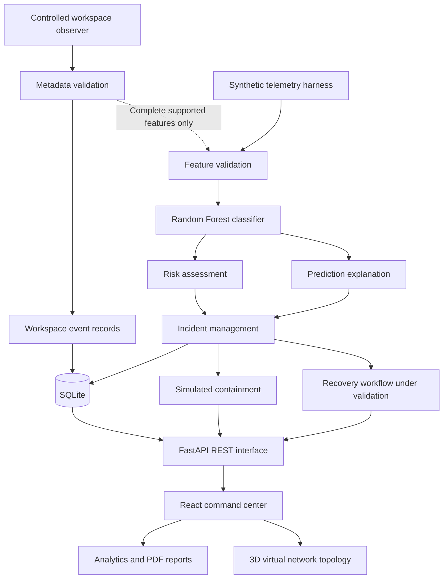
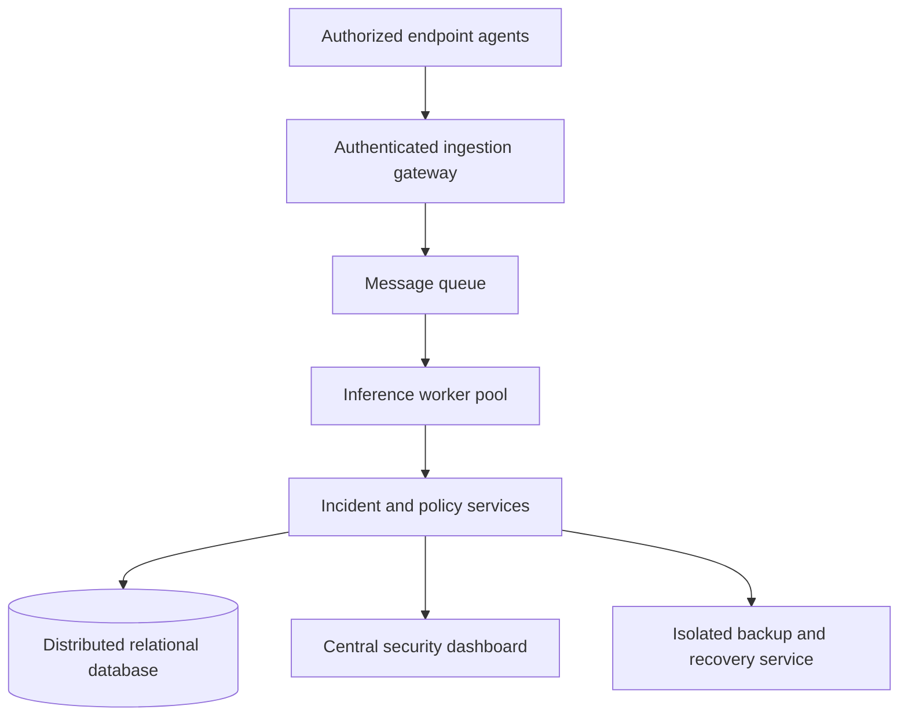

# NexusSentinel
Nexus Sentinel is an AI-powered cybersecurity prototype for FinTech, combining behavioural ransomware detection, explainable Random Forest intelligence, early warning, false-positive reduction, simulated containment, recovery workflows, and real-time security analytics to support business continuity and cyber resilience.


Nexus Sentinel
AI-Powered Behavioural Threat Detection and Cyber Resilience for FinTech
    
> Intelligence. Resilience. Protection.
Nexus Sentinel is a cybersecurity research prototype developed by Team Nexus to explore AI-assisted ransomware detection, explainable security decisions and business continuity in financial institutions.
Rather than relying exclusively on known malware signatures or fixed behavioural rules, Nexus Sentinel uses supervised machine learning to evaluate structured behavioural telemetry. It brings together early-warning evaluation, incident management, multi-endpoint visualization, controlled response simulations and recovery workflows in a unified command center.
Scope: This is a non-destructive hackathon prototype, not a production endpoint protection product. Threat scenarios use synthetic telemetry, containment is simulated, and reported model results are from controlled synthetic evaluations.
Table of Contents
Problem Statement
Proposed Solution
Key Features
System Architecture
Machine Learning Algorithm
Early-Warning Evaluation
Experimental Results
Recovery and Storage Efficiency
Technology Stack
Getting Started
Demonstration Workflow
Scalability
Limitations and Safety
Future Scope
Team and License
Problem Statement
Financial institutions depend on continuous access to transaction systems, customer records and operational infrastructure. Ransomware-related disruption can compromise data availability, integrity and business continuity.
Security systems must also distinguish suspicious behaviour from legitimate high-activity workloads, such as backups and compression. Excessive false positives can create alert fatigue and unnecessary operational disruption.
Nexus Sentinel investigates how behavioural machine learning can improve this balance while keeping security decisions understandable and computationally practical.
Proposed Solution
The platform combines structured telemetry analysis, a trained Random Forest classifier, explainable risk assessments, incident tracking and controlled response workflows.
Its primary objectives are to:
Recognize suspicious behavioural patterns in controlled telemetry.
Reduce unnecessary alerts from legitimate workloads.
Evaluate early-warning capability through reproducible sequence-based experiments.
Provide interpretable risk assessments and incident records.
Demonstrate selective virtual endpoint containment and resource management.
Explore integrity-verified backup recovery and business-aware incident prioritization.
Nexus Sentinel is intended as a complementary security intelligence layer, not a replacement for established antivirus or endpoint detection and response products.
Key Features
Module	Capability	Scope
Command Center	Central monitoring, risk visualization and incident overview	Prototype
Behavioural AI	Random Forest classification and risk scoring	Synthetic evaluation
Explainability	Feature analysis and prediction-level perturbation explanations	Prototype
Simulation Lab	Controlled benign and suspicious telemetry scenarios	Non-destructive simulation
Workspace Protection	Observation of supported file-system metadata in an authorized demo workspace	Limited real observation
Network Topology	Interactive visualization of virtual endpoints	Simulation
Gateway Protection	Bounded telemetry queues and throttling demonstrations	Simulation
Analytics	Classification metrics, confusion matrix and early-warning results	Synthetic benchmark
Incident Reports	Incident records and PDF reporting	Prototype
Recovery Vault	Clean backup restoration and integrity verification	Integration under validation
Business Impact Intelligence	Criticality-based prioritization and hypothetical exposure estimates	Proposed extension / verify availability
Audible and 3D alerts	Event-driven warning sound and mechanical core animation	Integration under validation
System Architecture

The architecture separates data collection, model inference, incident persistence and presentation. Workspace observations and synthetic model inputs have distinct provenance; incomplete workspace metadata must not be silently treated as a complete model feature vector.
Architectural Layers
Layer	Responsibility
Presentation	React dashboard, charts, navigation and 3D visualization
API	FastAPI request handling and structured responses
Intelligence	Feature validation, model inference and explanations
Persistence	SQLite assessment and incident records
Response	Simulated containment and gateway resource management
Recovery	Authorized backup copies and integrity checks, subject to integration validation
Machine Learning Algorithm
Random Forest Classifier
Random Forest is a supervised ensemble learning algorithm that combines multiple decision trees. Each tree learns relationships between numerical features and labelled classes. The forest combines the trees' probability estimates to classify new observations.
Nexus Sentinel uses binary classification:
Benign: legitimate behavioural observations.
Suspicious: observations representing suspicious behavioural patterns.
Why Random Forest?
Captures nonlinear relationships and feature interactions.
Reduces the variance associated with individual decision trees.
Supports feature importance and prediction analysis.
Provides practical CPU-based inference for structured numerical inputs.
Does not require an external AI service for local predictions.
Original Evaluated Configuration
Hyperparameter	Value
Number of estimators	120
Maximum tree depth	8
Minimum samples per leaf	3
Random state	42
Parallel workers	1
These values describe the original reported benchmark configuration; subsequent model revisions should be documented separately.
Model Inputs
Feature	Description
`file_mod_rate`	File modification activity rate
`entropy_delta`	Change in measured information randomness
`rename_ratio`	Proportion of relevant rename operations
`unique_ext_count`	Number of distinct represented file extensions
`burst_io_score`	Measure of concentrated input/output activity
`shadow_copy_access_flag`	Indicator of relevant snapshot-access activity
No individual feature establishes malicious intent. The model evaluates relationships across features. The workspace observer does not independently collect all six inputs; the controlled harness supplies complete synthetic feature vectors for model evaluation.
Risk Scoring and Explainability
The risk score is calculated from the model's estimated suspicious-class probability:
$$Risk = \operatorname{round}(100 \times P(\text{suspicious} \mid X))$$
The score is bounded between 0 and 100. It is an uncalibrated model estimate, not a guaranteed real-world probability of ransomware infection.
Global feature importance describes model-wide influence. Prediction-level perturbation analysis examines how changes to individual inputs affect a particular assessment. Such explanations indicate model sensitivity, not proven causation.
Training and Validation
The original reported experiment used 1,200 synthetic training observations and 600 synthetic validation observations, generated using separate random seeds. Both sets originated from the same synthetic generator, which limits conclusions about real-world generalization.
Early-Warning Evaluation
The sequence-based benchmark evaluates model alerts against a predefined simulated impact milestone. The alert must occur within the defined early-warning window to qualify as an early detection.

Lead time = simulated impact time − simulated alert time.
The reported median alert time was 6 seconds against an 8-second simulated milestone, yielding a median simulated lead time of 2 seconds. These timings do not establish real-world attack prevention or time-to-damage.
Experimental Results
Classification Benchmark
Metric	Reported result
Accuracy	98.83%
Precision	98.01%
Recall	98.50%
F1 score	98.25%
False-positive rate	1.00%
Validation observations	600
Confusion Matrix
Actual / Predicted	Benign	Suspicious
Benign	396 (TN)	4 (FP)
Suspicious	3 (FN)	197 (TP)
False-Positive Reduction
Metric	Baseline	Optimized model
False positives	89	4
False-positive rate	22.25%	1.00%
Relative reduction: (89 − 4) / 89 × 100 = 95.51%.
This is a relative reduction in false positives on the reported benchmark, not a measured reduction in real-world business downtime.
Sequence-Based Evaluation
Outcome	Result
Suspicious sequences	60
Early detections	58
Premature detections	2
Late detections	0
Missed detections	0
Early detection rate	96.67%
Benign sequences	60
Benign sequence false alarms	6 (10%)
Median simulated alert time	6 seconds
Simulated impact milestone	8 seconds
All figures are previously reported synthetic benchmark results. The sequence false-alarm rate and individual-observation false-positive rate measure different things. Independent real-world validation and reproducible evaluation artifacts are necessary before production claims can be made.
Recovery and Storage Efficiency
The Recovery Vault extension is designed to restore authorized clean backup copies into a separate recovery directory and compare SHA-256 digests to verify content integrity.
Potential storage optimizations include:
Content-based deduplication to avoid storing identical backup contents repeatedly.
Lossless compression where effective.
Incremental versioning to reduce redundant backup data.
Selective protection of business-critical documents.
Actual storage savings depend on the dataset. A matching SHA-256 digest verifies content consistency against a trusted reference; it does not prove a file is malware-free. Recovery from backups is not ransomware decryption. A local vault is not inherently ransomware-resistant.
Technology Stack
Technology	Purpose
React	Component-based frontend
Vite	Development server and production bundling
Tailwind CSS	Interface styling
Three.js, React Three Fiber, Drei	Interactive 3D visualization
Recharts	Analytical charts
Lucide React	Interface icons
Python	Backend and ML implementation
FastAPI, Uvicorn	REST API and ASGI serving
Scikit-learn	Random Forest training and inference
NumPy	Numerical feature processing
Joblib	Model serialization
SQLite	Local persistent storage
jsPDF, jsPDF-AutoTable	PDF report generation
Getting Started
Prerequisites
Python and a compatible virtual environment.
Node.js and npm.
Git.
A modern browser with WebGL support for 3D visualization.
Use the dependency manifests and model artifacts supplied by the repository. Exact dependency versions and installation paths should be checked against the current checkout.
Backend (Windows PowerShell)
From the repository root, after installing the declared Python dependencies into `.venv`:
```powershell
.\.venv\Scripts\python.exe -m uvicorn backend.main:app --host 127.0.0.1 --port 8000
```
API documentation: http://127.0.0.1:8000/docs
Frontend
In a separate terminal:
```powershell
cd frontend
npm install
npm run dev -- --host 127.0.0.1 --port 5173
```
Application: http://127.0.0.1:5173
Production Frontend Build
```bash
npm run build
```
Run from the frontend directory. Confirm that the backend is reachable and the frontend API configuration matches the running server before beginning a demonstration.
Demonstration Workflow
Open the command center and verify backend connectivity.
Run benign synthetic scenarios and inspect the model assessments.
Run the controlled suspicious telemetry scenario and inspect actual model predictions.
Review the resulting incident and simulated virtual endpoint containment.
Inspect analytics, confusion matrix and early-warning benchmark results.
If Recovery Vault integration is verified, restore a clean disposable backup copy and check its integrity.
Generate and inspect the relevant PDF report.
Only use authorized disposable demonstration data. No actual malware or destructive file operations are required.
Scalability
Current Prototype
The application supports local CPU-based inference, multiple virtual endpoints, modular REST services, SQLite persistence and bounded synthetic telemetry processing. Maximum endpoint capacity, concurrent user capacity and enterprise throughput have not been established through load testing.
Proposed Enterprise Architecture

Future scaling would involve horizontal inference workers, load balancing, secure telemetry ingestion, PostgreSQL or equivalent persistence, role-based access control and isolated backup infrastructure. This diagram represents a proposed architecture, not a deployed enterprise system.
Limitations and Safety
The reported model was evaluated on synthetic data from a shared generator.
Real-world ransomware and zero-day detection effectiveness are not established.
Containment and gateway protection are simulated rather than operating-system or network enforcement.
Workspace observation provides limited metadata, not full endpoint telemetry.
Risk probabilities are not calibrated against real-world incident frequencies.
Recovery API integration, audible warnings and event-driven sphere animations require final verification.
Enterprise scalability, unattended service operation and regulatory compliance have not been established.
The application must not be used as the sole protection mechanism for sensitive or production systems.
Future Scope
Independent evaluation on authorized real-world security telemetry.
Probability calibration and uncertainty-aware incident review.
Secure endpoint integration and administrator-approved response policies.
Business-criticality-aware incident prioritization.
Isolated, immutable backups and tested recovery objectives.
Distributed inference and enterprise load testing.
Authentication, role-based access control and tamper-evident audit records.
Integration with established EDR and SIEM platforms.
Assessment against applicable financial-sector security requirements.
Team and License
Developed by Team Nexus as a hackathon cybersecurity prototype.
See the repository's LICENSE file if one has been provided. No particular open-source license is asserted by this README.
---
Nexus Sentinel — From behavioural intelligence to cyber resilience.
